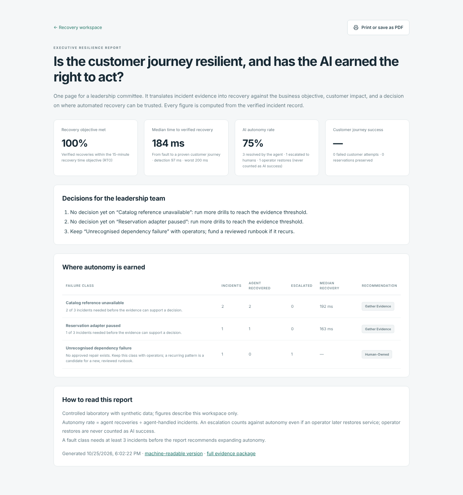
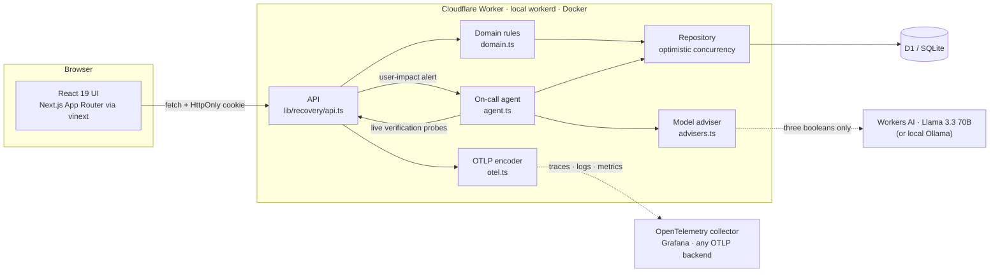
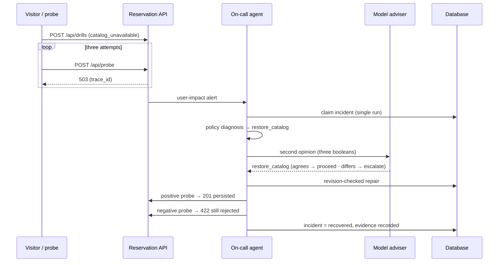

# Service Recovery Lab

[](https://github.com/cssaritama/Service-Recovery-Lab/actions/workflows/ci.yml)
[](LICENSE)


**Prove the journey works — not just the server.**

**▶ Live demo: [service-recovery-lab.cssaritama.workers.dev](https://service-recovery-lab.cssaritama.workers.dev)**, free to use with synthetic data and no sign-up.

Every organisation eventually lives the same moment: **the dashboards are green, and the customers cannot pay.**

In that moment no one is asking *"is the server up?"*. Three questions decide the outcome: *can our customers still do business with us, who fixed it, and how do we know?*

Service Recovery Lab answers those three questions in one working system:

- It alerts on **customer impact**.
- It lets an **AI agent repair the incident within limits a leader can defend**.
- It refuses to call anything "recovered" until the **customer journey itself is proven to work again**, and it keeps the evidence.


---

## Executive summary

| Question a leadership team asks | What the system does |
|---|---|
| *Are customers affected right now?* | Measures the critical journey (a booking) directly. Pages only when customers fail, not when a CPU graph moves. A green health check does not hide an outage. |
| *Can we trust AI to act in production?* | The on-call agent has **bounded autonomy**: two allowlisted repairs, revision-checked writes and a language-model second opinion that can confirm but never widen its authority. When unsure, it hands over to a human. |
| *Did we actually recover?* | "Recovered" requires a real customer-style booking to succeed **and** invalid input to still be rejected **and** existing records to be intact. Otherwise the incident escalates. |
| *Are we inside our recovery objective?* | Every verified recovery is measured against a **recovery time objective (RTO)** and reported as objective attainment, not as raw seconds. |
| *Where should we let AI act on its own, and where not?* | The **[executive resilience report](https://service-recovery-lab.cssaritama.workers.dev/report)** turns the incident record into a decision for each failure class: expand autonomy, keep human review, keep it human-owned, or gather more evidence. Expanding autonomy requires a minimum body of verified evidence. |
| *Can we show it to an auditor or a board?* | Every incident yields a causal, trace-linked record (fault → alert → diagnosis → repair → verification), exportable as JSON and as OpenTelemetry. |
| *What does it cost to run?* | It runs on free tiers (Cloudflare Workers, D1, Workers AI) and on any laptop with one Docker command. |

## The operating principles behind it

These principles come from data and AI leadership practice, and the code enforces each of them:

1. **Measure what the customer experiences.** The service-level indicator is *visitor booking success*. Process health is reported separately and deliberately stays green during failures, so the gap is visible.
2. **Autonomy is earned and bounded.** The agent may do exactly what has been approved, and nothing else. A model's opinion is advisory: if it disagrees with the observed state, the decision goes to a human.
3. **No claim without evidence.** A configuration change is not a recovery. Manual restores are recorded as operator actions, never as AI successes, so the metrics cannot flatter the automation.
4. **Privacy by design.** No personal data is collected. Telemetry and model prompts never contain request bodies, cookies or credentials, and tests enforce this.
5. **Humans own the irreversible decisions.** Production promotion is a manual, approved step. Rollback is one click, and every deployment is smoke-tested against the business journey.

## What this project demonstrates

| Discipline | How it shows up here |
|---|---|
| **Strategy** | The problem is framed around business continuity and regulatory direction, not technology. More than a dozen candidate problems were evaluated, the scope is explicit, and value hypotheses and a roadmap are written down ([strategy](docs/strategy.md)). |
| **Decision intelligence** | Operational telemetry becomes leadership decisions: objective attainment, AI autonomy rate and a per-failure-class recommendation on where automation has earned trust, in a one-page, printable executive report. |
| **Data** | A customer-journey indicator instead of proxy metrics. Explicit API contracts. Incident evidence as structured, exportable data. Privacy by design, enforced by tests. |
| **Architecture** | One edge-serverless artifact running identically on a laptop, in Docker and in the cloud. Optimistic concurrency on SQL. Every major choice recorded as a decision with its alternatives ([ADRs](docs/decisions/README.md)). |
| **Cloud and FinOps** | Runs entirely on free tiers (Cloudflare Workers, D1, Workers AI), with built-in caps that keep a public demo cost-bounded. |
| **AI governance** | Bounded autonomy, a model as second opinion rather than decision-maker, human escalation for the unknown, and an audit trail of what the model proposed. |
| **Operations** | Journey-level alerting, an on-call agent, verified recovery, runbooks, and OpenTelemetry evidence that is portable to any observability platform. |
| **Delivery** | 40 automated tests plus 5 browser journeys, enforced code style, CI on every change, automatic deployment to development, approved production promotion and one-click rollback. |
| **Leadership** | A human-led team of AI agents with defined roles, a public tracker, and independent verification before anything counts as done. |

## How it was built: one lead, a team of AI agents

I led this project as product owner and engineering lead for a small team of AI coding agents. I set the goals and constraints, directed the evaluation of more than a dozen candidate problems, approved the specification and scope, and own every release.

The agents worked as product, implementation, verification and delivery roles:

- the specification came before code;
- every task has acceptance criteria in a public tracker;
- verification was done by a different agent and tool than implementation;
- each session left an honest work log, failures included.

This is the operating model I advocate for organisations adopting AI: **humans set direction and guardrails, agents execute, and independent verification decides what is true.** Details: [agent team and process](docs/agent-team.md) · [work log](docs/agent-work-log.md) · [tracker](public/tracker.json).

---

## Where this goes next

Regulators are moving from *"have a recovery plan"* to *"prove that it works"*. The EU's Digital Operational Resilience Act, in force for financial entities since January 2025, is one example. At the same time, AI agents are entering operations. The natural evolution of this laboratory has three stages:

1. **Bring your own journey.** Point the probe and the agent at any HTTP journey, with the allowlist defined as policy-as-code.
2. **Integrations.** Connect to paging and chat tools.
3. **An executive resilience scorecard.** Journey SLOs and error budgets across services, with evidence packages ready for audit.

Details: [strategy, value and roadmap](docs/strategy.md).

## Try it in five minutes

Open the **[live demo](https://service-recovery-lab.cssaritama.workers.dev)**, or run it yourself:

```bash
docker compose up --build          # app + database, one command
# open http://localhost:3000
```

Or without Docker (Node.js 24+): `npm ci && npm run local`.

1. **Book a reservation.** It persists in the database and survives a reload.
2. **Run the guided recovery drill** (*Catalog reference unavailable*). Three real bookings fail with HTTP 503, and the user-impact alert fires.
3. **Watch the agent:** observe → diagnose (with a model's second opinion in the cloud) → revision-checked repair → verification through the live API. Typically about one second in the lab.
4. **Open *Journey telemetry*.** One trace ID links the span, the structured log and the metric. Download the same data as OpenTelemetry.
5. **Try *Unrecognized dependency failure*.** The correct outcome is **escalation**. The agent does not guess.
6. **Export the evidence package.** Your original booking is still there.
7. **Open the [executive report](https://service-recovery-lab.cssaritama.workers.dev/report).** The drills you ran become objective attainment, an AI autonomy rate and a decision per failure class, on one printable page.

| Executive report | Correlated telemetry | Mobile |
|---|---|---|
|  |  |  |

---

## The problem in detail

- **Health checks stay green while the journey is broken.** A missing configuration reference, a paused downstream adapter or a bad deploy can make every booking fail while `/health` still returns `200 OK`.
- **Alerts fire on the wrong signal.** Infrastructure metrics and error counts that include user mistakes create noise. What should page someone is *customers failing to complete the critical journey*.
- **"We restored it" is often unverified.** Recovery is real only when the journey succeeds again, validation still holds and customer records are intact.
- **Unbounded automation is a new risk.** An agent that can do anything can also break anything. The useful version has a small, explicit authority and escalates when unsure.
- **Evidence is lost.** Post-incident reviews reconstruct events from scattered logs, when they need a causal timeline.

Recovery testing is established practice (for example in [CISA's ransomware guidance](https://www.cisa.gov/stopransomware/ransomware-guide)), but most tooling targets large backup estates. Teams lack a reproducible, journey-level way to practise and prove recovery.

## Architecture



| Layer | Technology |
|---|---|
| Frontend | React 19, Next.js App Router on vinext (Vite), Tailwind CSS 4 |
| Backend | TypeScript on Cloudflare Workers (`workerd` locally and in Docker) |
| Data | Cloudflare D1 (SQLite) with Drizzle migrations |
| AI | Cloudflare Workers AI (Llama 3.3 70B in JSON mode, configurable) as an advisory reasoner; Ollama locally |
| Observability | OpenTelemetry OTLP/JSON traces, logs and metrics; Grafana LGTM stack via Docker; Workers Logs |
| Quality | Node.js test runner, Playwright, ESLint, Prettier |
| Delivery | Docker Compose, GitHub Actions (CI → automatic dev → manual production → rollback) |

Design decisions and trade-offs: [docs/architecture.md](docs/architecture.md).

## How recovery works



The guardrails cannot be bypassed:
- Only `restore_catalog` and `resume_adapter` exist.
- Repairs are compare-and-swap on the configuration revision.
- Each incident is claimed by a single run.
- Probes use their own slot and never consume customer capacity.
- The agent never edits reservations, never relaxes validation and never executes generated code.

## Engineering quality

- **40 automated tests plus 5 browser journeys, one command** (`npm test`):
  - 9 domain unit tests
  - 9 model-adviser tests (JSON mode, parsing, response formats, timeouts, disagreement → escalation)
  - 4 OpenTelemetry tests (encoding, a real HTTP collector, redaction)
  - 5 executive-report tests (objective attainment, autonomy rate, evidence thresholds, escalations never flattering the AI)
  - 13 integration tests on a real SQLite database (isolation, concurrency without overselling, end-to-end recovery, stale and duplicate agent runs, persistence)
  - 5 Playwright browser journeys (desktop, mobile and the executive report)
  
  See [docs/testing.md](docs/testing.md).
- **CI on every pull request:** formatting, lint, tests, then the full system in Docker with a journey smoke test.
- **CD:** automatic deployment to development, a manual and approved production promotion, and rollback to a verified version.
- **Operations:** runbooks for the alert, the agent and rollback ([docs/operations.md](docs/operations.md)). Optional local Grafana with `docker compose -f compose.yaml -f compose.observability.yaml up --build`.

## Scope and honest limits

- This is a **controlled laboratory** with synthetic data. It is not a backup product, does not test external systems and does not certify ransomware resilience.
- Recovery times and the [benchmark](evidence/performance.json) (48 bookings, 12 concurrent sessions, p95 ≈ 233 ms on a laptop) are lab observations, not SLOs.
- Mature products exist in adjacent spaces, for example backup verification and AI incident tooling. This project is a reference implementation of the operating model, not a validated commercial product.

## Repository layout

```
app/                   UI: recovery workspace, /report (executive report), /guide, /tracker
lib/recovery/          domain · agent · advisers (Workers AI / Ollama) · report (executive) · otel (OTLP) · api · repository
db/, drizzle/          schema and SQL migrations
worker/                Cloudflare Worker entry point
tests/                 unit, adviser, OpenTelemetry, integration and browser tests
scripts/               local runner, tests, smoke test, benchmark, demo capture, cloud config, tracker sync
.github/workflows/     CI, deploy-development, deploy-production (manual), rollback
docs/                  strategy, decisions (ADRs), spec, architecture, agent team, testing, operations, deployment, reviewer guide
evidence/              demo recording, evidence export, benchmark, console check
```

## For reviewers

This repository is also my capstone for the [AI Dev Tools Zoomcamp](https://github.com/DataTalksClub/ai-dev-tools-zoomcamp/tree/main/project) (DataTalks.Club). The criterion-by-criterion evidence, with files, commands and tests, is in **[docs/reviewer-guide.md](docs/reviewer-guide.md)**, and [AGENTS.md](AGENTS.md) is the entry point for the agent context. All documentation is in English and all data is synthetic.

## About the author

**Carlos Saritama**

> *The next decade will not belong to the companies with the most AI, but to the ones that can trust it.*

I design and build Data & AI systems meant to be trusted: measurable by executives, verifiable by auditors and invisible to customers. Service Recovery Lab turns that conviction into working code: **autonomy is earned with evidence.**

## License

[MIT](LICENSE)
