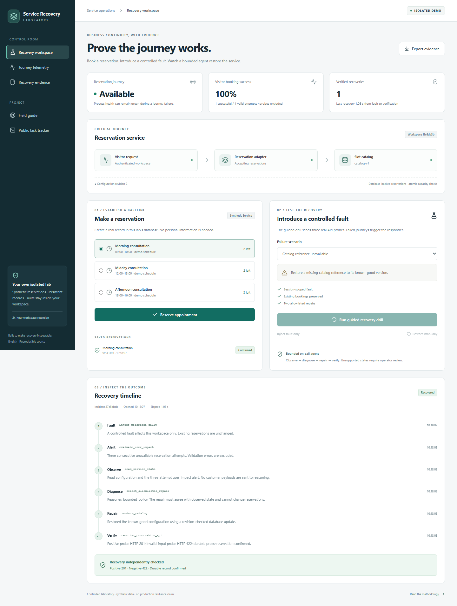
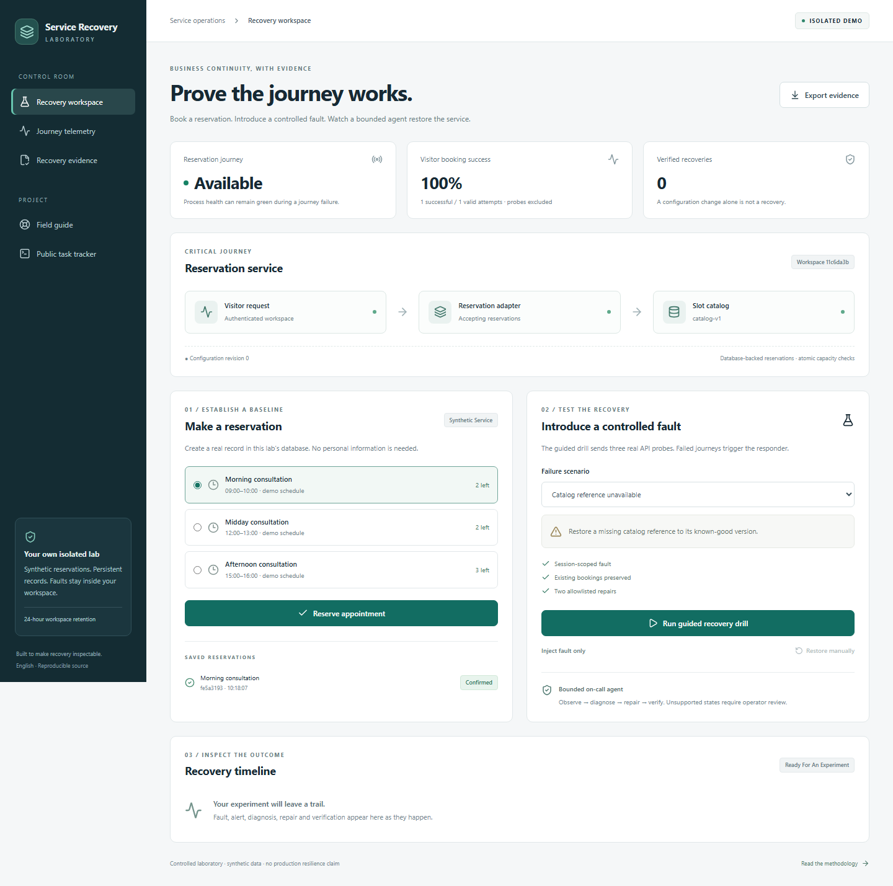
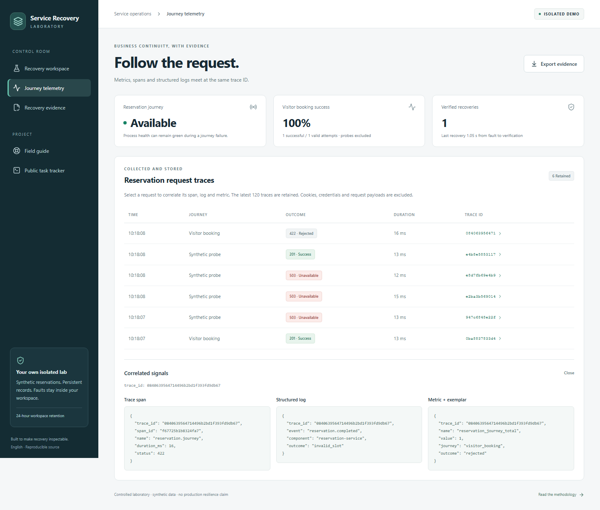
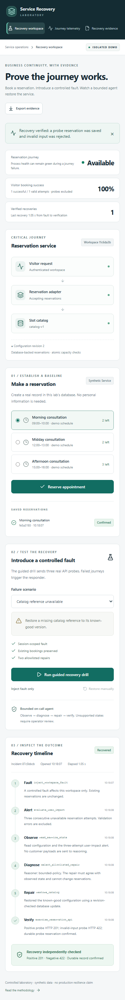
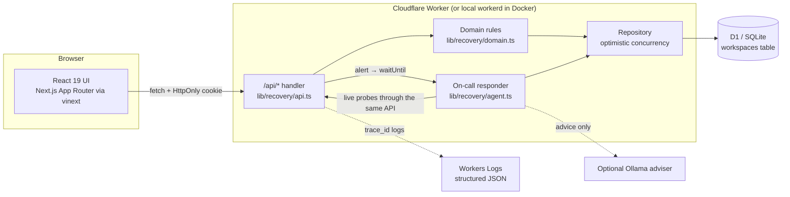
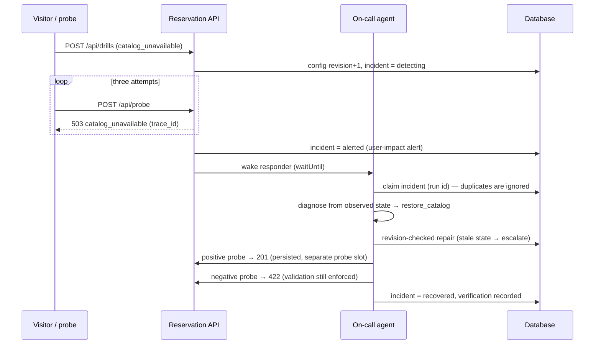

# Service Recovery Lab

**Prove the journey works — not just the server.**

Service Recovery Lab is a full-stack laboratory for one question every operations leader eventually has to answer under pressure: *after something breaks, can a customer actually complete the thing they came to do?*

It runs a small but real reservation service, lets you inject a controlled fault, alerts on **user impact** (failed bookings, not CPU graphs), wakes a **bounded on-call agent** that diagnoses and repairs the fault, and then **verifies recovery against the live business journey** before it is allowed to say "recovered". Every step leaves a trace-correlated, exportable evidence trail.



> Final project for the [AI Dev Tools Zoomcamp](https://github.com/DataTalksClub/ai-dev-tools-zoomcamp/tree/main/project) (DataTalks.Club). Documentation is in English; all data is synthetic.

---

## Contents

1. [The problem](#1-the-problem)
2. [The solution](#2-the-solution)
3. [What you can do with it](#3-what-you-can-do-with-it-a-five-minute-experiment)
4. [Quick start](#4-quick-start)
5. [Architecture](#5-architecture)
6. [How recovery works](#6-how-recovery-works)
7. [Testing](#7-testing)
8. [Containers, deployment and CI/CD](#8-containers-deployment-and-cicd)
9. [Observability and alerting](#9-observability-and-alerting)
10. [How this project was built: agents, specs and tracker](#10-how-this-project-was-built)
11. [Evaluation criteria map](#11-evaluation-criteria-map)
12. [Scope, limits and honest claims](#12-scope-limits-and-honest-claims)
13. [Repository layout](#13-repository-layout)

---

## 1. The problem

Most monitoring answers *"is the process alive?"*. Customers care whether *"can I book, pay, submit, or check out?"* works. Those are different questions, and the gap between them is where incidents hide:

- **Health checks stay green while the journey is broken.** A process can return `200 OK` on `/health` while a missing configuration reference, a paused downstream adapter, or a bad deploy makes every real booking fail. In this lab, `/api/health` deliberately stays green during every drill — so you can see the gap.
- **Alerts fire on the wrong signal.** CPU, memory, and error counts that include user mistakes (invalid input) generate noise. What should page someone is *"customers are failing to complete the critical journey"*.
- **"We restored it" is often an unverified claim.** A configuration change is not a recovery. Recovery is only real when the journey succeeds again, bad input is still rejected, and existing customer records are intact.
- **Automation without bounds is a new risk.** Letting an AI agent "fix production" is attractive, but an agent that can do anything can also break anything. The useful version is an agent with an explicit, small authority: a short allowlist of repairs, revision-checked writes, and mandatory escalation when it is unsure.
- **Evidence is lost.** After an incident, teams reconstruct what happened from scattered logs. Auditors, executives and post-mortems need a causal timeline: fault → alert → diagnosis → repair → verification.

Recovery testing is recognised practice — for example, [CISA's ransomware guidance](https://www.cisa.gov/stopransomware/ransomware-guide) recommends preparing and testing recovery — but most tooling targets large backup estates. Small teams lack a **reproducible, inspectable, journey-level** way to practise and prove recovery.

## 2. The solution

Service Recovery Lab makes that whole loop concrete in one application:

| Capability | What it means in the lab |
|---|---|
| **A real critical journey** | Visitors book appointment slots. Capacity checks are atomic, retries are idempotent, and records persist in a database. |
| **Controlled, isolated faults** | Three drills — *catalog reference unavailable*, *reservation adapter paused*, and *unrecognised dependency failure* — affect only the visitor's own workspace. |
| **User-impact alerting** | The alert fires after **three consecutive failed booking attempts (HTTP 5xx)**. Validation errors (HTTP 4xx) never count. |
| **Bounded on-call agent** | The alert wakes a responder that follows *observe → diagnose → repair → verify*. It may apply only two allowlisted repairs and must escalate anything else. |
| **Verification against the journey** | "Recovered" requires a persisted positive probe booking (HTTP 201) **and** a negative probe that is still rejected (HTTP 422). Failed verification escalates. |
| **Correlated telemetry** | Each request emits a span, a structured log and a metric that share one trace ID. Payloads, cookies and credentials are excluded. |
| **Exportable evidence** | One click exports a JSON evidence package: timeline, telemetry, agent decisions, verification and preserved records. |

The design principle throughout: **no claim without evidence.** The UI distinguishes autonomous recovery from manual restore, and process health from journey health. It never reports recovery that was not verified.

## 3. What you can do with it (a five-minute experiment)

1. **Book a reservation.** It appears under *Saved reservations* and survives a page reload.
2. **Run the guided recovery drill** (*Catalog reference unavailable*). The lab sends three real API probes; they fail with HTTP 503 and the user-impact alert fires.
3. **Watch the timeline.** The agent observes state, selects `restore_catalog`, applies it with a revision check, then verifies with live probes. Typical lab time from fault to verified recovery is about one second.
4. **Open *Journey telemetry*.** Click any trace ID to see the span, structured log and metric that share it.
5. **Try *Unrecognized dependency failure*.** The correct outcome is **escalation**: the agent refuses to guess. Use *Restore manually*. The incident is recorded as *cancelled*, never as an agent recovery.
6. **Export evidence** and inspect the JSON. Your original reservation is still there.

| Baseline booking | Correlated telemetry | Mobile |
|---|---|---|
|  |  |  |

A recorded walkthrough is available at [`evidence/local-demo.webm`](evidence/local-demo.webm).

## 4. Quick start

**Option A — Docker (one command, includes the database)**

```bash
docker compose up --build
# open http://localhost:3000
```

The container builds the app, applies database migrations to a persistent volume (`recovery-data`) and serves on port 3000. Data survives `docker compose down` / `up`.

**Option B — Node.js (no Docker)**

Requires Node.js 24 or later (`.nvmrc` provided).

```bash
npm ci
npm run local        # builds, migrates the local database, serves http://127.0.0.1:3000
```

**Run every test with one command**

```bash
npx playwright install chromium   # first time only
npm test                          # typecheck → unit + integration → production build → browser tests
```

**Optional: language-model adviser.** By default the responder is a deterministic, tool-using policy. To let a local model *advise* on the diagnosis, set `OLLAMA_URL` (see [`config/environment.example`](config/environment.example)). The model can only propose one of the allowlisted actions; if it disagrees with the observed state, the agent escalates. See [docs/operations.md](docs/operations.md#optional-model-adviser).

## 5. Architecture



| Layer | Technology | Why |
|---|---|---|
| Frontend | React 19, Next.js App Router on **vinext** (Vite), Tailwind CSS 4 | Modern React with server rendering on the edge runtime |
| Backend | TypeScript on **Cloudflare Workers** (local: `workerd` via Wrangler) | Same runtime locally, in Docker and in the cloud; free tier for a public demo |
| Database | **Cloudflare D1** (SQLite), schema and migrations with **Drizzle** | Real persistence and SQL migrations, local and remote |
| Tests | Node.js test runner, Playwright | Fast unit and integration tests; real-browser journey tests |
| Delivery | Docker, Docker Compose, GitHub Actions, Wrangler | One-command start, CI on every PR, automatic dev deploy, manual production promotion, rollback |

Full detail, data model and design decisions: **[docs/architecture.md](docs/architecture.md)**.

## 6. How recovery works



**Guardrails the agent cannot bypass**

- Only two repairs exist: `restore_catalog` and `resume_adapter`. Anything else → `escalate`.
- Repairs are compare-and-swap on the configuration revision. If the operator changed something meanwhile, the stale repair is rejected.
- A single agent run claims each incident. Concurrent invocations cannot repair twice.
- Probe bookings use a reserved probe slot and never consume customer capacity.
- The agent never edits reservations, never disables validation and never executes generated code.

## 7. Testing

`npm test` runs four stages and stops at the first failure:

| Stage | Command | What it covers |
|---|---|---|
| Typecheck | `tsc --noEmit` | Whole codebase |
| **Unit** (9) | `tests/domain.test.mjs` | Capacity, idempotency, input validation, fault diagnosis, alert threshold (5xx only), telemetry bounds, probe isolation, manual restore ≠ agent recovery |
| **Integration** (13) | `tests/integration.test.mjs` | Real HTTP handler + real SQLite with the production migration: cookie isolation, forged cookies, cross-origin rejection, concurrent bookings (no overselling), end-to-end alert → agent → verified recovery for both faults, escalation, telemetry redaction, persistence across restart, stale and concurrent agent runs, failed verification |
| Build | `vinext build` | Production Worker bundle |
| **Frontend / E2E** (4) | `tests/browser/journeys.spec.ts` | Booking + reload + guided recovery + telemetry drill-down + evidence export; escalation + manual restore; two isolated browser sessions; mobile layout and keyboard navigation |

Latest local run: **22/22 unit + integration passed, 4/4 browser tests passed**, plus the deployment smoke test. Details: **[docs/testing.md](docs/testing.md)**.

## 8. Containers, deployment and CI/CD

- **Docker:** a multi-stage [`Dockerfile`](Dockerfile) runs as non-root, with a health check. [`compose.yaml`](compose.yaml) starts the full system, database included, with `docker compose up --build`.
- **CI** ([`ci.yml`](.github/workflows/ci.yml)) runs on every pull request and every push to `main`: install, browsers, `npm test`, then a container job that runs `docker compose up --wait` and the smoke test against the container.
- **CD to development** ([`deploy-development.yml`](.github/workflows/deploy-development.yml)) runs automatically after CI passes on `main`. It applies D1 migrations, deploys the Worker and runs the smoke test against the public URL.
- **Manual production promotion** ([`deploy-production.yml`](.github/workflows/deploy-production.yml)) is `workflow_dispatch` only, gated by the `production` environment. It re-runs the full test suite before deploying.
- **Rollback** ([`rollback.yml`](.github/workflows/rollback.yml)) restores a previously verified Worker version ID in either environment, then runs the smoke test.

The [smoke test](scripts/smoke.mjs) is a production-grade check of the business journey, not of process health. It books, injects a fault, confirms failure, waits for the agent, and asserts verified recovery with the original booking intact.

Setup takes about 15 minutes on the Cloudflare free tier: **[docs/deployment.md](docs/deployment.md)**.

## 9. Observability and alerting

- **One trace ID per request** links a span (`reservation.journey`, duration and status), a structured log (`reservation.completed`, outcome code) and a metric (`reservation_journey_total{journey, outcome}`). The trace ID is also returned in the `x-trace-id` response header.
- **Stored and viewable.** Signals are stored per workspace in the database and shown in the *Journey telemetry* view. Click a trace ID to see all three signals side by side. In the cloud, the same `trace_id` appears in Cloudflare Workers Logs (observability is enabled in the Worker configuration).
- **Privacy by design.** Request bodies, cookies, session tokens and raw exceptions never enter telemetry or exports. An integration test plants a secret string in a request and asserts it never appears.
- **The alert is on user impact:** three consecutive server-side booking failures, real visitors and synthetic probes alike. The alert records the triggering trace ID, so the incident links back to the exact failing request.

Runbooks for the alert, the agent and rollback: **[docs/operations.md](docs/operations.md)**.

## 10. How this project was built

The project followed a spec-first, tracker-driven, agent-assisted workflow:

1. **Specification before code.** [docs/product-spec.md](docs/product-spec.md) defines the problem, the user, accepted behaviour and 21 acceptance scenarios. It was written before domain implementation.
2. **Public task tracker.** Seven tasks with observable acceptance criteria live in [`public/tracker.json`](public/tracker.json). They are rendered publicly at **`/tracker`** in the running app and mirrored to GitHub Issues with [`scripts/sync-tracker-issues.mjs`](scripts/sync-tracker-issues.mjs).
3. **Defined agent team.** Product, implementation, verification and delivery roles each have a scope, inputs, outputs and hand-off rules, with a human owner approving scope and releases. See **[docs/agent-team.md](docs/agent-team.md)**.
4. **Context management.** [AGENTS.md](AGENTS.md) is the entry point for any coding agent. It points to modular docs for the spec, architecture, team and process, testing and operations.
5. **Honest work log.** [docs/agent-work-log.md](docs/agent-work-log.md) records what each agent session actually did and verified, including the issues found and fixed during independent review.

## 11. Evaluation criteria map

| # | Criterion | Where the evidence is |
|---|---|---|
| 1 | Problem description | This README, sections 1–3 |
| 2 | Product specification + public tracker | [product-spec.md](docs/product-spec.md), [tracker.json](public/tracker.json), `/tracker` page, GitHub Issues |
| 3 | Agent team specification | [agent-team.md](docs/agent-team.md) |
| 4 | Context management | [AGENTS.md](AGENTS.md) → modular docs |
| 5 | Application (FE + BE + DB, one command) | Sections 4–5, `npm run local`, `docker compose up` |
| 6 | Testing (unit + integration, one command) | Section 7, `npm test` |
| 7 | Containerization | [Dockerfile](Dockerfile), [compose.yaml](compose.yaml) |
| 8 | Deployment | [deployment.md](docs/deployment.md), public URL below |
| 9 | CI/CD (tests → dev → manual prod) | [.github/workflows](.github/workflows) |
| 10 | Observability | Section 9 |
| 11 | Alerting on user impact | Section 9, [operations.md](docs/operations.md) |
| 12 | On-call agent | Section 6, [agent.ts](lib/recovery/agent.ts) |

The criterion-by-criterion reviewer guide, with exact files, commands and tests: **[docs/rubric-evidence.md](docs/rubric-evidence.md)**.

**Live demo:** _add your public URL here after the first deployment — see [docs/deployment.md](docs/deployment.md)._

## 12. Scope, limits and honest claims

- This is a **controlled laboratory** with synthetic data. It is not a backup product, does not test external systems and does not certify ransomware resilience.
- Recovery times are observations of a lab experiment, not production SLOs. The benchmark in [`evidence/performance.json`](evidence/performance.json) is a small local test (48 bookings, 12 concurrent sessions, p95 ≈ 233 ms on a laptop), not a capacity claim.
- Mature products exist in adjacent spaces, such as [Veeam SureBackup](https://helpcenter.veeam.com/docs/vbr/userguide/surebackup_job_hv.html) for backup verification. This project contributes a small, reproducible, journey-level workflow for teaching, evaluation and design discussion. Commercial demand has not been validated.
- The public demo bounds its own growth: workspaces expire after 24 hours, at most 1,000 workspaces, 12 drills and 80 probes per workspace, and the last 120 traces.

## 13. Repository layout

```
app/                   UI: recovery workspace, /guide (field guide), /tracker (public tracker)
lib/recovery/          domain.ts (rules) · agent.ts (responder) · api.ts (HTTP) · repository.ts (DB)
db/, drizzle/          Drizzle schema and SQL migrations
worker/                Cloudflare Worker entry point
tests/                 unit, integration (SQLite) and browser (Playwright) tests
scripts/               local runner, test runner, smoke test, benchmark, demo capture, cloud config
.github/workflows/     CI, deploy-development, deploy-production (manual), rollback
docs/                  spec, architecture, agent team, testing, operations, deployment, rubric evidence
evidence/              recorded demo, example evidence export, benchmark, browser console check
public/tracker.json    public task tracker with acceptance criteria
AGENTS.md              entry point for coding agents
```

## License

[MIT](LICENSE) © Carlos Saritama
