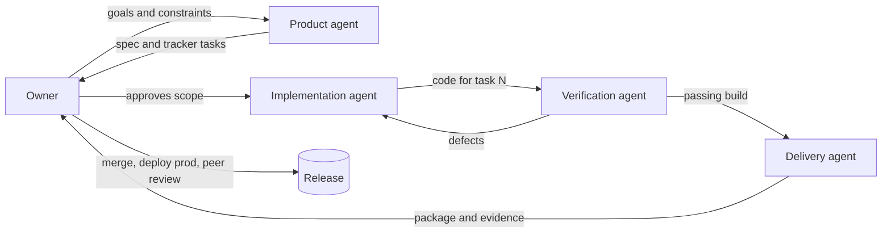

# Agent team and development process

This project was built by a small team: one human owner and AI coding agents with explicit roles. The roles are defined by **responsibility and hand-off**, not by which tool happened to run them. One agent session may play several roles in sequence. When it does, it changes role explicitly and follows that role's rules.

A separate, **runtime** agent (the on-call responder) is part of the product itself. It is described at the end.

## Development team

| Role | Performed by | Responsibilities | Inputs | Outputs | Done when |
|---|---|---|---|---|---|
| **Owner** | Human (repository owner) | Sets goals and constraints: course rubric, zero budget, English, synthetic data. Chooses the topic. Approves scope and releases. Operates accounts: GitHub, Cloudflare, peer reviews. | Course requirements, portfolio goals | Decisions, approvals, credentials (never shared with agents) | Release approved |
| **Product agent** | Coding agent | Research and topic evaluation. Writes the problem statement, specification and acceptance scenarios **before** domain code. Creates tracker tasks. | Owner goals | `docs/product-spec.md`, `public/tracker.json` | Every task has observable acceptance criteria |
| **Implementation agent** | Coding agent | Builds the domain, API, persistence, responder and UI against one tracker task at a time. | Spec, tracker task, `AGENTS.md` | Source code, migrations | Task criteria demonstrably met |
| **Verification agent** | Coding agent (independent session from implementation where possible) | Writes and runs unit, integration and browser tests. Reviews the code against the spec. Reports defects back to implementation. | Spec, code | `tests/`, test results, defect list | All tests pass in one command; defects fixed or recorded |
| **Delivery agent** | Coding agent | Containers, CI/CD, rollback, documentation, evidence capture, submission packaging. | Verified build | `Dockerfile`, `compose.yaml`, workflows, `docs/`, `evidence/` | Reviewer can reproduce every claim from the repository |

## How the team works together

1. **Spec first.** No domain code before `docs/product-spec.md` and the tracker tasks exist. A behaviour change that is not in the spec starts with a spec update.
2. **One task at a time.** Each agent starts by reading `AGENTS.md`, the spec and the tracker task, then states the expected outcome. It moves the task to `in_progress` and to `done` only when all acceptance criteria are verified.
3. **Evidence over assertion.** A status change must be backed by a test, a command output or a file in `evidence/`. Configuration files do not count as proof that a deployment ran.
4. **Separation of build and review.** The verification role runs from a fresh context (it re-reads the spec, not the implementer's notes) so the work is not graded by its author. In this project the final verification was performed by a different agent and tool than the implementation; see the work log.
5. **Logged hand-offs.** Each session appends what it read, changed and verified to `docs/agent-work-log.md`, including failures.
6. **Human gates.** The owner alone holds credentials, approves the production environment, merges to `main` and completes peer reviews.

## Agent rules (enforced through `AGENTS.md`)

- Never fabricate collaborators, test results, deployments or commercial outcomes.
- Preserve session isolation, cookie authorisation, idempotency, bounded recovery and telemetry redaction.
- Never weaken validation to make a test pass.
- Keep secrets, dependency folders, runtime databases and caches out of commits and archives.
- All product copy and documentation are in English.

## Runtime agent: the on-call responder

| Property | Value |
|---|---|
| Trigger | User-impact alert: three consecutive 5xx booking attempts in a workspace |
| Tools | `read_service_state`, `select_allowlisted_repair`, `restore_catalog` / `resume_adapter`, `exercise_reservation_api`, `request_operator_review` |
| Authority | Two configuration repairs, scoped to one workspace, revision-checked |
| Cannot | Edit reservations, change validation, touch other workspaces, run code, act on unknown faults |
| Reasoner | Deterministic policy by default. An optional local LLM (Ollama) may advise, but disagreement → escalate. |
| Success | Positive probe 201 **and** negative probe 422 **and** persisted probe record **and** no remaining fault |
| Otherwise | Escalate to the operator with the reason recorded in the timeline |

Implementation: [`lib/recovery/agent.ts`](../lib/recovery/agent.ts). Runbook: [operations.md](operations.md).
