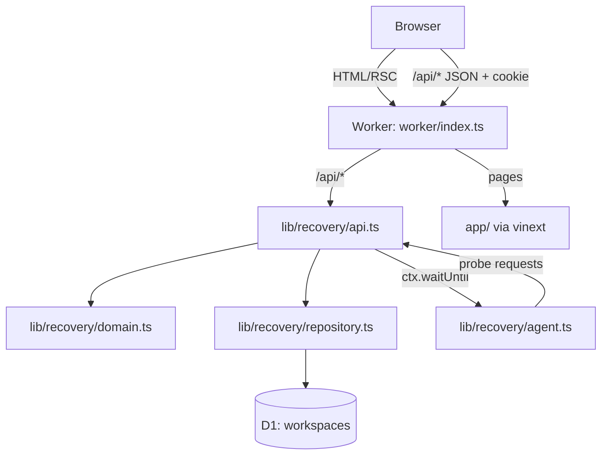

# Architecture

## System context

Service Recovery Lab is one deployable unit: a Cloudflare Worker that serves both the React UI and a JSON API, backed by a D1 (SQLite) database. The same Worker runs in three places with no code changes:

| Environment | Runtime | Database |
|---|---|---|
| Local (`npm run local`) | `workerd` through Wrangler | Local D1 under `.wrangler/state` |
| Docker (`docker compose up`) | `workerd` inside `node:24-bookworm-slim` | Local D1 on the `recovery-data` volume |
| Cloud (`development`, `production`) | Cloudflare Workers | Remote D1 database per environment |



## Components

### UI — `app/`
- `app/page.tsx`: the recovery workspace, a client component. It has three views: *Recovery workspace* (book, drill, timeline), *Journey telemetry* (trace table and correlated signal detail) and *Recovery evidence* (verification summary and incident history). It polls `/api/workspace` once per second only while an incident is active.
- `app/guide/page.tsx`: the field guide and methodology.
- `app/tracker/page.tsx`: the public task tracker, rendered from `public/tracker.json`.
- Accessibility: skip link, semantic landmarks, labelled controls, keyboard operation, responsive down to 360 px. Reduced motion is respected.

### API — `lib/recovery/api.ts`
A framework-free `Request → Response` handler, so it can be tested without a server.

| Method and path | Purpose |
|---|---|
| `GET /api/health` | Process health only. It deliberately stays green during journey failures. |
| `POST /api/session` | Creates an isolated workspace and sets an `HttpOnly; SameSite=Strict` cookie |
| `GET /api/workspace` | Workspace snapshot: slots with remaining capacity, reservations, incident, traces, metrics |
| `GET /api/evidence` | The same snapshot as a downloadable, sanitised evidence package |
| `POST /api/reservations` | Visitor booking. Requires an `Idempotency-Key` header. |
| `POST /api/probe` | Synthetic probe booking against the reserved probe slot |
| `POST /api/drills` | Starts a controlled fault: `catalog_unavailable`, `adapter_paused` or `unknown_dependency` |
| `POST /api/restore` | Operator manual restore. It is recorded as *cancelled*, never as an agent recovery. |

Hardening:
- JSON-only bodies of at most 4 KB.
- Cross-origin `POST` rejected using `Origin` and `Sec-Fetch-Site`.
- `no-store` caching and `nosniff`.
- A trace ID on every response, including errors.

### Domain — `lib/recovery/domain.ts`
Pure functions over a `State` document:
- `reserve` handles validation, idempotency (same key + same payload → replay; same key + different payload → 409), atomic capacity and fault gating.
- `recordAttempt` records telemetry and holds the alert rule.
- `startDrill` and `manualRestore` change configuration.
- `availability` computes remaining capacity per slot.

No I/O happens here, which makes the business rules fully unit-testable.

### On-call agent — `lib/recovery/agent.ts`
A tool-using state machine with four phases: **observe → diagnose → repair → verify**. See [operations.md](operations.md) for its authority and runbook.

### Repository — `lib/recovery/repository.ts`
- Each workspace is one row holding a JSON document plus a `revision` counter.
- `mutate()` uses **optimistic concurrency**. It reads, applies the change, then runs `UPDATE … WHERE revision = ?`, retrying up to 24 times with backoff. This is what makes concurrent bookings safe (no overselling) and lets a single agent run claim an incident.
- Session tokens are random 256-bit values. Only their SHA-256 hash is stored.
- Growth limits: 24-hour expiry, at most 1,000 workspaces and 240 KB per document.

## Data model

```sql
CREATE TABLE workspaces (
  id          TEXT PRIMARY KEY,
  token_hash  TEXT NOT NULL UNIQUE,   -- SHA-256 of the session cookie
  document    TEXT NOT NULL,          -- JSON State (see below)
  revision    INTEGER NOT NULL DEFAULT 0,
  created_at  INTEGER NOT NULL,
  expires_at  INTEGER NOT NULL
);
CREATE INDEX workspaces_expiry ON workspaces (expires_at);
```

The `State` document contains:
- `config`: catalog reference, adapter state, unknown-fault flag and configuration revision.
- `slots` and `reservations`; probe reservations are flagged.
- The current `incident` and its timeline `steps`, plus a bounded `history`.
- `traces` (the last 120 spans, each with its log and metric) and aggregate `metrics`.

Migrations live in `drizzle/` and are applied by Wrangler in every environment.

## Key design decisions

| Decision | Alternatives considered | Rationale |
|---|---|---|
| Alert on consecutive **5xx booking failures**, excluding 4xx | CPU/latency thresholds; any error | Measures customer impact. Invalid input is the user's error, not an outage. |
| **Deterministic policy** as the default reasoner, LLM optional and advisory | LLM decides and acts | The repair must be reproducible and safe in a public demo at zero cost. A model can add value as a second opinion but never gains authority. |
| Verification needs **positive and negative** probes plus persistence | Positive probe only; config check only | A fix that disables validation would pass a positive-only check. Config checks do not prove the journey works. |
| **Per-visitor workspace** isolation | Shared global demo state | Public visitors can break things safely without affecting anyone else. |
| Document-per-workspace with **revision CAS** | Normalised tables with row locks | D1/SQLite has no long-lived transactions across requests. CAS gives atomic multi-field updates and simple stale-write protection. |
| **Cloudflare Workers + D1** | Container on a VM, Postgres | Free tier, global edge, identical local runtime (`workerd`). One artifact for local, Docker and cloud. |
| Probe slot separate from customer inventory | Probes book real slots | Monitoring must never consume or distort the business resource it measures. |
